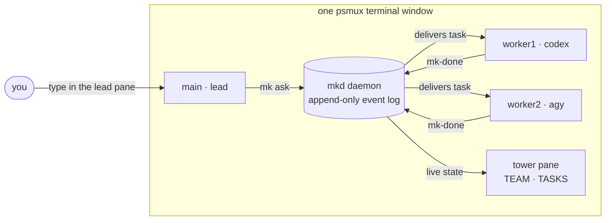

<div align="center">

# ⬢ MKCREW

### Your AI coding crew, in one Windows terminal.

Run a **team** of real agent CLIs — **Claude Code, Codex, opencode, Antigravity** — side by side in a
native-Windows cockpit. A **lead** delegates, **workers** build, and an event-sourced **control tower**
shows every job live.

[](#-install)
[](#-faq)
[](#-install)
[](#-install)
[](https://github.com/rayngnpc/psmux-mk)

**[Install](#-install)** · **[Quickstart](#-quickstart)** · **[How it works](#-how-it-works)** ·
**[Commands](#-commands)** · **[FAQ](#-faq)**

</div>

---

```text
┌─ MKCREW ───────────────────┬────────────────────────────────────────────┐
│                            │  worker1 · codex                           │
│   main · claude            │  ready                                     │
│   (lead)                   ├────────────────────────────────────────────┤
│   > mk ask worker2         │  worker2 · claude                          │
│     "fix the tests"        │  working: fix #12                          │
├────────────────────────────┤                                            │
│   ⬢ MKCREW tower           │                                            │
│   TEAM · TASKS             │                                            │
└────────────────────────────┴────────────────────────────────────────────┘
```

Every pane is a **real, interactive CLI** — the same `claude` / `codex` you use every day, with your
existing logins and plans. No headless mode or SDK. MKCREW turns them into a crew.

## ✨ Why MKCREW

- 🪟 **Native Windows.** No WSL, no Docker, no Linux VM. Built on [psmux](https://github.com/psmux/psmux), a Windows tmux.
- 👥 **A real team, visible.** Up to 6 seats in Studio — a lead, workers, and an optional planner — each in its own pane. Watch them work, or jump into any pane and type.
- 📜 **Event-sourced.** Every delegation is an append-only event. The control tower (TEAM / TASKS) is rebuilt live from the log across cockpit restarts.
- 🔌 **Mix providers per pane.** Lead on Claude, workers on Codex + Antigravity? One dropdown each.
- 🖥️ **Studio GUI.** `mk studio` opens a browser cockpit-builder: pick a folder, team size, per-pane providers, a layout — save it as a profile, hit Launch.
- 🧰 **Zero-force installer.** Checks everything, asks before installing in interactive mode, and uses user-scope installs by default.

## 🚀 Install

**One command** (PowerShell, no clone, installs only what's missing — uv → Python → MKCREW → psmux):

```powershell
powershell -ExecutionPolicy Bypass -c "irm https://raw.githubusercontent.com/rayngnpc/mkcrew/main/install.ps1 | iex"
```

The installer is an arrow-key menu with three modes — **INSTALL** (confirms each item), **AUDIT**
(read-only report, changes nothing), **AUTO** (unattended). Then log into at least one agent CLI
(e.g. `npm i -g @anthropic-ai/claude-code`, then run `claude` once) and you're done.
When running `install.ps1` directly, `-Yes` selects AUTO and `-CheckOnly` selects AUDIT.

**Or zero-install:** grab **[MKCREW.exe](https://github.com/rayngnpc/mkcrew/releases/latest)** — a single
standalone app (psmux bundled inside; no Python/uv needed). Just add an agent CLI + login.

<details>
<summary><b>Other ways to install</b> (clone for development · manual)</summary>

**Clone + editable install** (develop MKCREW itself):

```powershell
git clone https://github.com/rayngnpc/mkcrew
cd mkcrew
.\install.bat          # same installer; detects the clone and installs --editable
```

**Manual** (you manage prerequisites yourself):

1. [uv](https://docs.astral.sh/uv/) — `uv tool install https://github.com/rayngnpc/mkcrew/archive/refs/heads/main.tar.gz`
2. psmux fork on PATH — grab the [release binary](https://github.com/rayngnpc/psmux-mk/releases) (upstream `cargo install psmux` is **not** the same). Verify: `psmux -V` → `tmux 3.3.6`.
3. One agent CLI on PATH: `claude`, `codex`, `opencode`, or `agy`.

**Upgrade / uninstall:** `uv tool upgrade mkcrew` · `uv tool uninstall mkcrew`

</details>

## ⚡ Quickstart

```powershell
mk studio        # browser GUI: folder, team size, providers, layout -> Launch
```

In Studio, choose the folder and seats, then use each seat's inline CLI, model and effort menus.
Pick a layout card and a mode from the decision table; save or load a profile to reuse a crew.
The launch bar shows whether a cockpit is running and offers Stop or Relaunch when applicable.
The eight modes are **Standard**, **Fast**, **Thorough**, **Plan First**, **Architect**, **War Room**,
**Chief Architect**, and **Venture**.

…or straight from the terminal:

```powershell
cd path\to\your\project
mk start --no-attach  # build the cockpit: daemon + a psmux pane per teammate
mk attach        # step inside
```

Inside the cockpit, the **lead** delegates and the crew reports back:

```text
mk ask worker1 "write unit tests for parser.py"     # blocks until worker1 replies
mk status                                           # who is doing what
mk pend                                             # jobs
```

Tear down with `mk kill` — session IDs persist per project. Resumable agents can continue on restart;
shared Codex, OpenCode, or Antigravity seats start fresh to avoid reopening the same last session.

## 🧭 How it works



- **`mk` CLI** talks to a tiny local daemon (**`mkd`**) over localhost.
- The daemon **routes tasks to each worker's interactive CLI** and collects replies via `mk-done` — the crew feels autonomous, but every agent stays a normal, take-over-able terminal.
- State lives in a per-project **append-only SQLite event log** under `%LOCALAPPDATA%\mkcrew\runtime\projects\<project hash>\events.db` by default. `MK_RUNTIME_ROOT` can override the runtime root.
- The status pane is the **tower**; its pane title remains `core - control tower`, and its command is `mk-core-view`.

### Layouts

| Template | Shape |
|---|---|
| **Lead Left** | lead top-left, workers stacked on the right, tower bottom-left |
| **Side by Side** | all agents in a row, full-width control tower below |
| **Pages** | agents in a grid, six to a window, each window with a control tower strip (`Ctrl-b n` to flip) |

A saved **Lead Left + Files IDE** layout opens as **Lead Left** with a notice.

### Peek

Press **Ctrl-b f** anywhere in the cockpit to float **peek** over the cockpit's project, or run `mk peek [dir]` in any terminal: a read-only panel of the project's files. The popup uses the project that started the cockpit, even from another workspace tab. Files with uncommitted changes are on top, newest first, each with its age and its diff; typing filters across every file. Nothing is edited here: **Enter** hands the file to your editor and **Esc** gives the cockpit back.

| Key | Does |
|---|---|
| typing | filter (every word must appear in the path) |
| `↑` `↓` | move |
| `PgUp` `PgDn` | scroll the preview |
| `Enter` | open in the editor git uses; set it once with `git config --global core.editor notepad` |
| `Ctrl-y` | copy the path; paste it from the Windows clipboard |
| `Esc` | close |

## 🛠 Commands

| Command | What it does |
|---|---|
| `mk studio` | browser GUI — build the team visually, save/load profiles, launch |
| `mk init` | configure a team for the current project |
| `mk start` / `mk attach` / `mk kill` | cockpit lifecycle for the current folder |
| `mk ask <role> "<task>"` | delegate; blocks until that teammate replies |
| `mk status` / `mk pend` / `mk trace <job>` | tower snapshot · jobs · one job's full history |
| `mk stats` | per-worker delivery metrics from the event log |
| `mk tui` | open the live observability TUI |
| `mk peek [dir]` | open the read-only files peek (defaults to current directory) |
| `mk add <dir>` | add another project as a new workspace tab in the running cockpit |
| `mk open <dir>` | resume a previously configured workspace |
| `mk workspaces` | list configured workspaces |
| `mk layout [name]` | show or set a layout; `auto` selects a fit for the running cockpit |
| `mk relayout <name>` | rebuild the cockpit with a different layout |
| `mk mode [mode]` | show or switch the crew's mode |
| `mk doctor` | prerequisite health check |
| `mk verify` | check project configuration and crew invariants |
| `mk panic` / `mk resume` | halt the team / clear the daemon's paused state |
| `mk repair resubmit <job>` | resubmit an in-flight job |

Inside the cockpit: **Ctrl-b a** add a workspace · **Ctrl-b f** peek files · **Ctrl-b n** switch workspaces · **Ctrl-b x** close one · **Ctrl-b Esc** unstick a pane (exit copy-mode).

## ❓ FAQ

<details>
<summary><b>Do I need API keys?</b></summary>

MKCREW drives the **interactive CLIs you already use** (`claude`, `codex`, `opencode`, `agy`).
Your CLI's login or provider credentials, plans and rate limits apply — MKCREW never calls a model API itself.
</details>

<details>
<summary><b>Why a psmux fork instead of upstream?</b></summary>

Upstream psmux + Windows ConPTY mis-handle a few things full-screen TUIs depend on (scroll/copy-mode
traps, popup input, pane focus). The [psmux-mk fork](https://github.com/rayngnpc/psmux-mk) fixes them.
The installer downloads the prebuilt binary — no Rust toolchain needed.
</details>

<details>
<summary><b>"Running scripts is disabled" / execution-policy errors?</b></summary>

Use the install command as written (`-ExecutionPolicy Bypass` applies to that process only), and the
installer additionally self-heals: it applies a transient process-scope Bypass and *offers* to persist
`RemoteSigned` for your user (no admin, asks first).
</details>

<details>
<summary><b>Does anything need administrator rights?</b></summary>

No. uv, Python, MKCREW, psmux and all PATH changes are user-scope. The only optional step that may
show UAC is installing Node via winget — and it asks first.
</details>

<details>
<summary><b>Two agents on the same provider — do they collide?</b></summary>

No. Panes get per-pane identity and sessions. When Codex, OpenCode, or Antigravity is shared by multiple
seats, MKCREW starts those seats fresh rather than resuming the same last conversation in each pane.
</details>

<details>
<summary><b>Which font and editor does the cockpit use?</b></summary>

The cockpit tries Cascadia Mono when available, otherwise Consolas. Peek uses git's editor; on Windows,
it falls back to Notepad if that editor cannot be found.
</details>

## 🙌 Credits

Built on **[psmux](https://crates.io/crates/psmux)** (MIT) — a native-Windows tmux clone, driven via its
CLI through the [psmux-mk fork](https://github.com/rayngnpc/psmux-mk).
